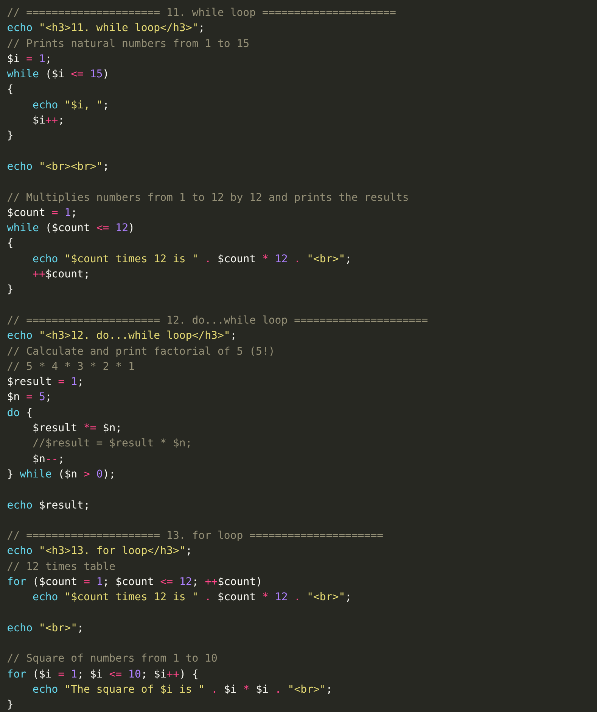

# Week 2 — Code Explanation

## 1. Loops 

### while loop

- Loop 1: starts at `$i = 1`, runs **while** `$i <= 15`, adds 1 each time → prints 1 to 15.
- Loop 2: `$count` goes from 1 to 12 and prints `$count * 12` → the 12 times table.
- If you forget `$i++`, the loop never ends (infinite loop).

### do...while loop (factorial)

- The code inside `do { }` runs **first**, then the condition is checked.
- Each round: `$result *= $n;` then `$n--;`
- Rounds: 1×5=5 → 5×4=20 → 20×3=60 → 60×2=120 → 120×1=120.
- Result: **120** = 5! (5 factorial).

### for loop

- `for (start; condition; step)` — all three parts in **one line**.
- Loop 1 prints the 12 times table.
- Loop 2 prints the square of 1 to 10 using `$i * $i`.
- The dot `.` joins the text and the number.

---

## 2. Break Continue And Nested Loops 

### break and continue

- **break:** when `$i` becomes 10, the loop **stops**. So it prints only 1 to 9.
- **continue:** `$i % 2 == 0` means `$i` is **even**. For even numbers, `continue` **skips** the `echo`. So only **odd** numbers print: 1, 3, 5, … 15.

### Nested loops

- The **outer** loop (`$i`) makes the **rows** (1 to 12).
- The **inner** loop (`$j`) makes the **columns** (1 to 12).
- Each cell shows `$i * $j`.
- We print HTML tags `<table>`, `<tr>` (row) and `<td>` (cell) so the result looks like a table.
- The inner loop runs fully (12 times) for **each** round of the outer loop → 12 × 12 = 144 cells.
