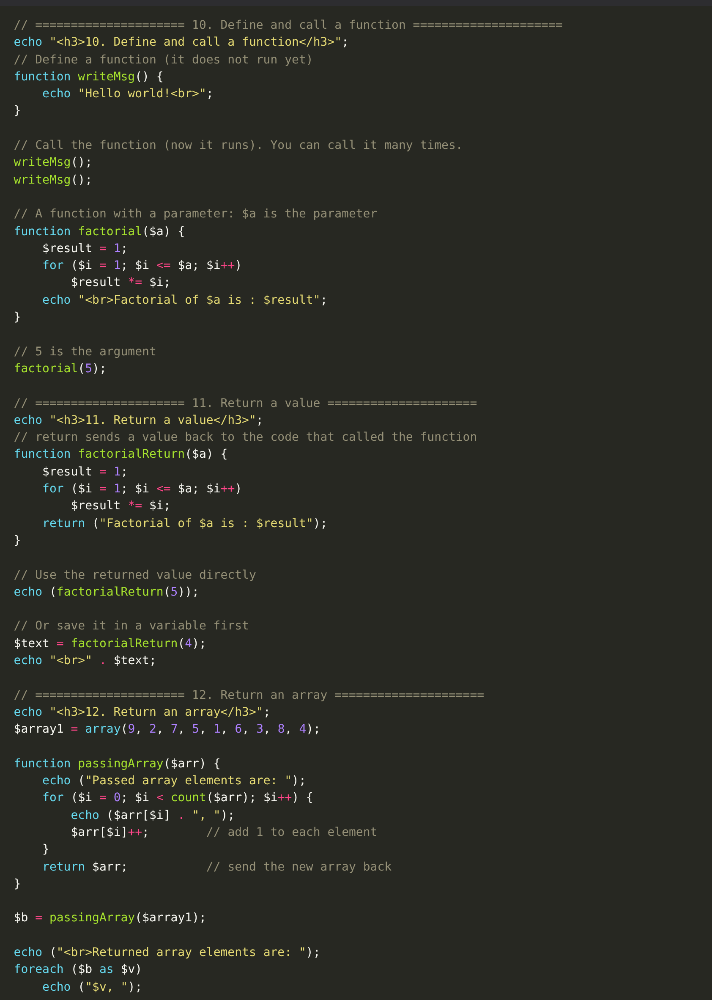

# Week 3 — Code Explanation

All the code for this week is in **one file: [`index.php`](../index.php)**.
Each screenshot shows one topic: the **code** from `index.php` (top, with the real line numbers) and the **result in the browser** (bottom).

**To run it:** copy the `Week 3` folder into `C:\xampp\htdocs\` and rename it to `week3`. Start Apache, then open `http://localhost/week3/`.

> **Note:** Some slide examples had small mistakes (for example `$numbers[0]` instead of `$fruits[0]`, and a `$student` array that was not created). In `index.php` they are fixed so the code runs.
>
> All examples are in one file, so each factorial function has its own name (`factorialReturn`, `factorialByRef`, `factorialDefault`, `factorialScope`). PHP does not allow two functions with the same name in one file.

---

## 1. Indexed Arrays (lines 10–63)

### Creating indexed arrays

- **Way 1:** `array("Apple", "Orange", "Banana")` — PHP gives indexes 0, 1, 2. `$fruits[0]` is `Apple`.
- **Way 2:** we write the index ourselves: `$fruits[1] = "Orange"`.
- **Way 3:** `$colors[] = "Red";` — empty brackets add the value to the **end**.
- `<pre>` + `print_r()` show the array with its indexes in a clean way.

### Loop with for

- `$info` holds 5 values about a person.
- `count($info)` = 5, so `$i` goes 0, 1, 2, 3, 4.
- `$info[$i]` gets each value and prints it on a new line.

### foreach loop

- `foreach ($numbers as $n)` — on each round, `$n` holds the next element: 26, then 11, then 13.
- Second part: we **add** all elements: `$total += $n;` → 10 + 10 + 15 = **35**.

---

## 2. Associative Arrays (lines 65–95)

### Associative arrays

- Each value has a **name** (key): `"name" => "Mohamed Abdi Ali"`.
- `$info["name"]` gets one value by its key.
- `foreach ($info as $a)` prints **only the values**.
- `foreach ($info as $k => $v)` prints the **key and the value**: `[age]: 20`.
- `print_r()` shows the structure; `var_dump()` also shows the **type and length** (e.g. `string(16)`, `int(20)`, `float(160.5)`).

---

## 3. Multidimensional Arrays (lines 97–119)

### 2D arrays

- `$student` is an array of 3 arrays — like a table with 3 rows and 4 columns.
- **Way 1:** one `foreach`. `$k` is one row; `$k[0]`, `$k[1]`, … are its columns.
- **Way 2:** a loop **inside** a loop. The outer loop gets a row, the inner loop prints each value.
- `$student[1][0]` → row 1, column 0 → `Ahmed`.

---

## 4. Array Functions Part 1 (lines 121–170)

### is_array, in_array, count

- `is_array($info)` → true → `Yes, it is an array`.
- `in_array("Ahmed", $info)` → `Ahmed` is in the array → true.
- `count()` and `sizeof()` both give **4**.

### max, min and sorting

- `max()` → 9, `min()` → 1.
- `sort()` → small to big. `rsort()` → big to small.
- `implode(", ", $numbers)` turns the array into one string so we can print it with `echo`.
- `asort()` sorts the associative array by **value** (70, 82, 95) and **keeps the keys**.
- `arsort()` does the same but big to small.

---

## 5. Array Functions Part 2 (lines 172–212)

### explode, implode, shuffle, merge, reverse

- `explode(" ", $a)` cuts the sentence at every **space** → an array of 9 words.
- `implode(" - ", $b)` joins them back with ` - `.
- `shuffle($b)` mixes the words in **random** order (your result will be different each time).
- `array_merge($a1, $a2)` → `1, 2, 3, 1, 5, 6`.
- `array_reverse($a3)` → `6, 5, 1, 3, 2, 1`.

### array_push, array_pop, end

- `array_push($a, 10)` adds 10 to the end and **returns 5** (the new count).
- `array_pop($a)` removes the last element and **returns it** → 4. The array becomes `1, 2, 3`.
- `end($p)` returns the **last element** → 1.

---

## 6. Functions (lines 214–270)

### Define and call a function

- `function writeMsg() { ... }` **defines** the function. Nothing happens yet.
- `writeMsg();` **calls** it. We call it twice, so `Hello world!` appears twice.
- `factorial($a)`: `$a` is the **parameter**. In `factorial(5)`, `5` is the **argument**.
- The `for` loop multiplies 1 × 2 × 3 × 4 × 5 = **120**.

### Return a value

- This time the function does **not** echo. It **returns** the text.
- `echo (factorialReturn(5));` prints the returned text directly.
- `$text = factorialReturn(4);` saves the returned text in a variable, then we print it.

### Return an array

- We send `$array1` to the function.
- Inside, the `for` loop prints each element, then adds 1 to it: `$arr[$i]++`.
- `return $arr;` sends the **new array** back. We save it in `$b`.
- Result: `9, 2, 7 …` becomes `10, 3, 8 …`.
- Returning an array is a way to get **many values** from a function.

---

## 7. By Reference And Default Argument (lines 272–307)

### By value vs by reference

- **By value:** `addOne($x)` changes only a **copy**. `$n` is still **5**.
- **By reference:** `factorialByRef(&$x)` — the `&` means the function works on the **original** `$a`.
- Inside, `$x++` changes `$a` from 5 to **6**. That is why the output shows `Value of a = 6`.

### Default argument

- `function factorialDefault($a = 5)` — if we do not give an argument, `$a` is 5.
- `factorialDefault();` → 5! = 120.
- `factorialDefault(3);` → 3! = 6.

---

## 8. Variable Scope (lines 309–335)

### Local and global variables

- `$a = 5;` outside the function → **global**.
- `$a = 10;` inside the function → **local**. It is a different variable with the same name.
- Inside the function, `$a` means the local one (10).
- `$GLOBALS["a"]` reaches the global one (5).
- `showCity()` uses `global $city;` to read the global `$city` from inside the function.

---

## 9. Include Files (lines 337–350)

### Including files

- `library.php` holds two functions: `greet()` and `square()`.
- `require_once "library.php";` loads that file **one time**. Now we can use its functions.
- If `library.php` is missing, `require_once` **stops** the script with a fatal error (`include` would only give a warning).
- `function_exists("square")` → true. `function_exists("cube")` → false, because no function named `cube` was created.
- ⚠️ Keep `library.php` in the **same folder** as `index.php`.
