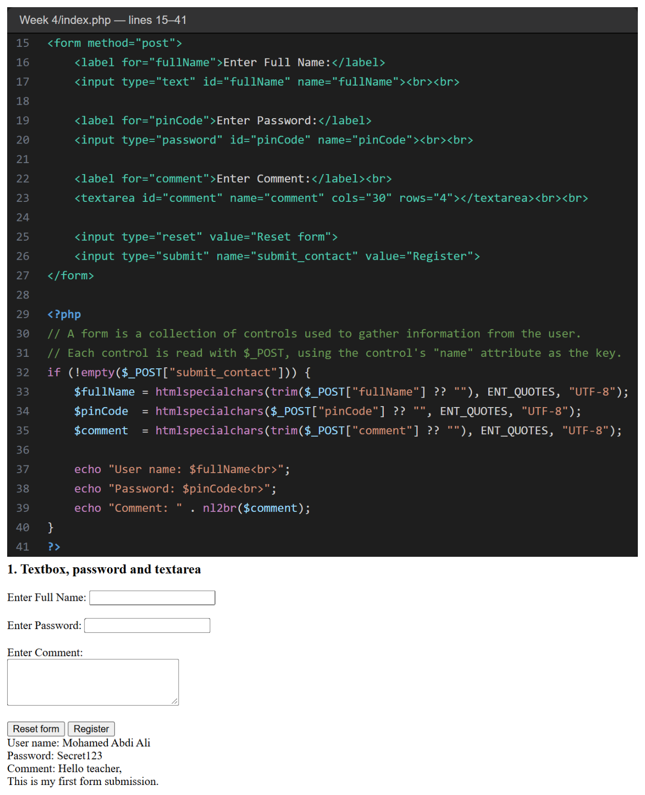
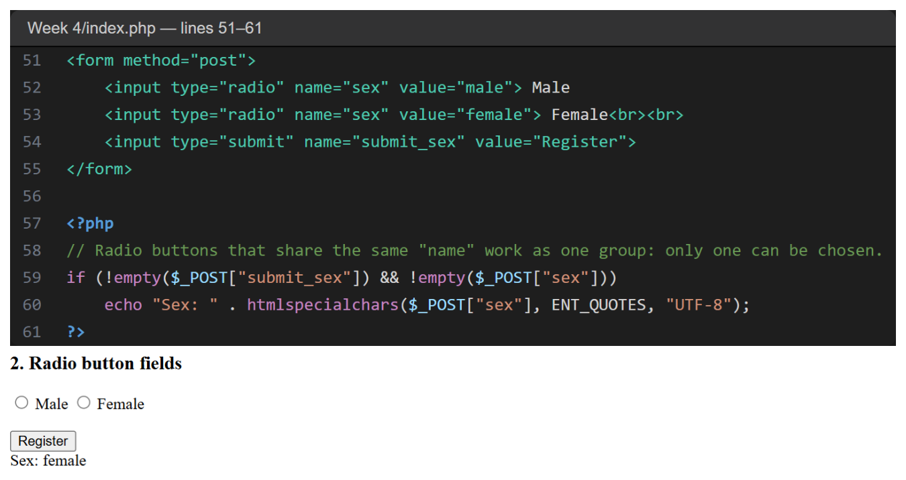
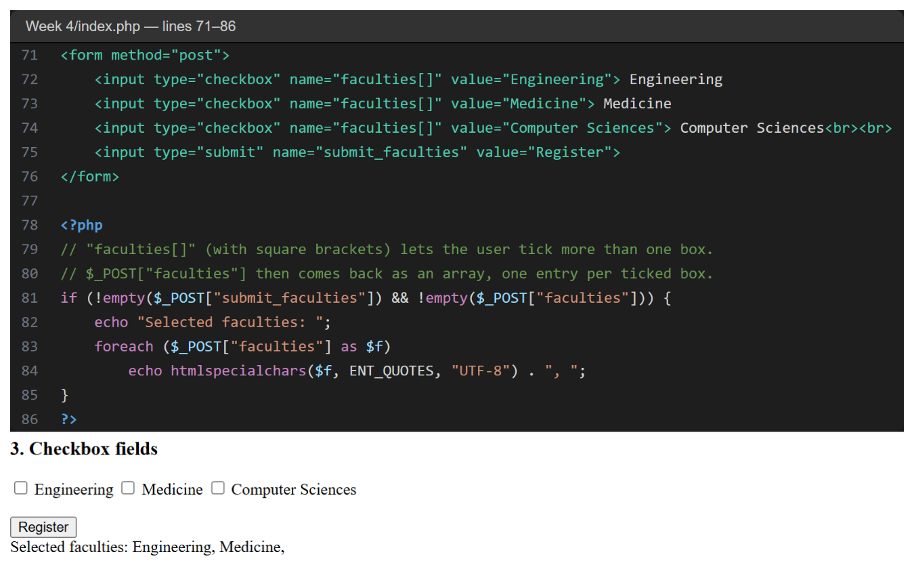
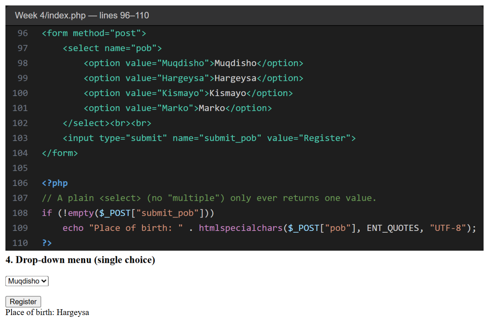

# Week 4 — Code Explanation

All the code for this week is in **one file: [`index.php`](../index.php)**.
Each screenshot shows one topic: the **code** from `index.php` (top, with the real line numbers) and the **result in the browser**, after submitting the form with sample data (bottom).

**To run it:** copy the `Week 4` folder into `C:\xampp\htdocs\` and rename it to `week4`. Start Apache, then open `http://localhost/week4/`.

---

## 1. Textbox, Password and Textarea (lines 15–41)

- One `<form>` has three controls: a text box (`fullName`), a password field (`pinCode`) and a `<textarea>` (`comment`).
- The form submits to itself (`method="post"`, no `action`), and `submit_contact` is the name of its submit button.
- `!empty($_POST["submit_contact"])` makes sure PHP only reacts to **this** form — important once a page has several forms, since all their fields arrive together in `$_POST`.
- Each value is cleaned with `htmlspecialchars()` (and `trim()` for the text fields) before it is echoed back, so the page cannot be broken by HTML typed into the form.
- `nl2br($comment)` turns the line breaks the user typed in the textarea into ` ` tags, so multi-line comments display correctly.
- The screenshot shows the result after typing a name, a password and a two-line comment, then clicking **Register**. Note the fields show empty again after submit — the form does not keep the typed values, it only prints them below.

---

## 2. Radio Button Fields (lines 51–61)

- Two radio inputs share `name="sex"`, so the browser only lets one of them be selected.
- After submitting, `$_POST["sex"]` holds whichever value (`male` or `female`) was chosen.
- `!empty($_POST["sex"])` guards against the case where the user submits without choosing either button.
- The screenshot shows **Female** selected and submitted, printing `Sex: female`.

---

## 3. Checkbox Fields (lines 71–86)

- Three checkboxes all use `name="faculties[]"`. The square brackets tell PHP to collect every ticked value into **one array** called `faculties`, instead of overwriting a single value each time.
- `foreach ($_POST["faculties"] as $f)` walks through that array and prints every faculty the user ticked, separated by commas.
- If no box is ticked, `$_POST["faculties"]` is not set, so the `!empty(...)` check skips the loop safely.
- The screenshot shows **Engineering** and **Medicine** ticked, printing `Selected faculties: Engineering, Medicine,`.

---

## 4. Drop-down Menu — Single Choice (lines 96–110)

- `<select name="pob">` with four `<option>` tags lets the user pick **one** city.
- Because the `<select>` has no `multiple` attribute, `$_POST["pob"]` always holds a single value, not an array.
- The screenshot shows **Hargeysa** chosen, printing `Place of birth: Hargeysa`.
- Compare this with the **listbox** (`<select multiple>`) example in [Week 5](../../Week%205/dropdown.php), where the same kind of control instead returns an array.
