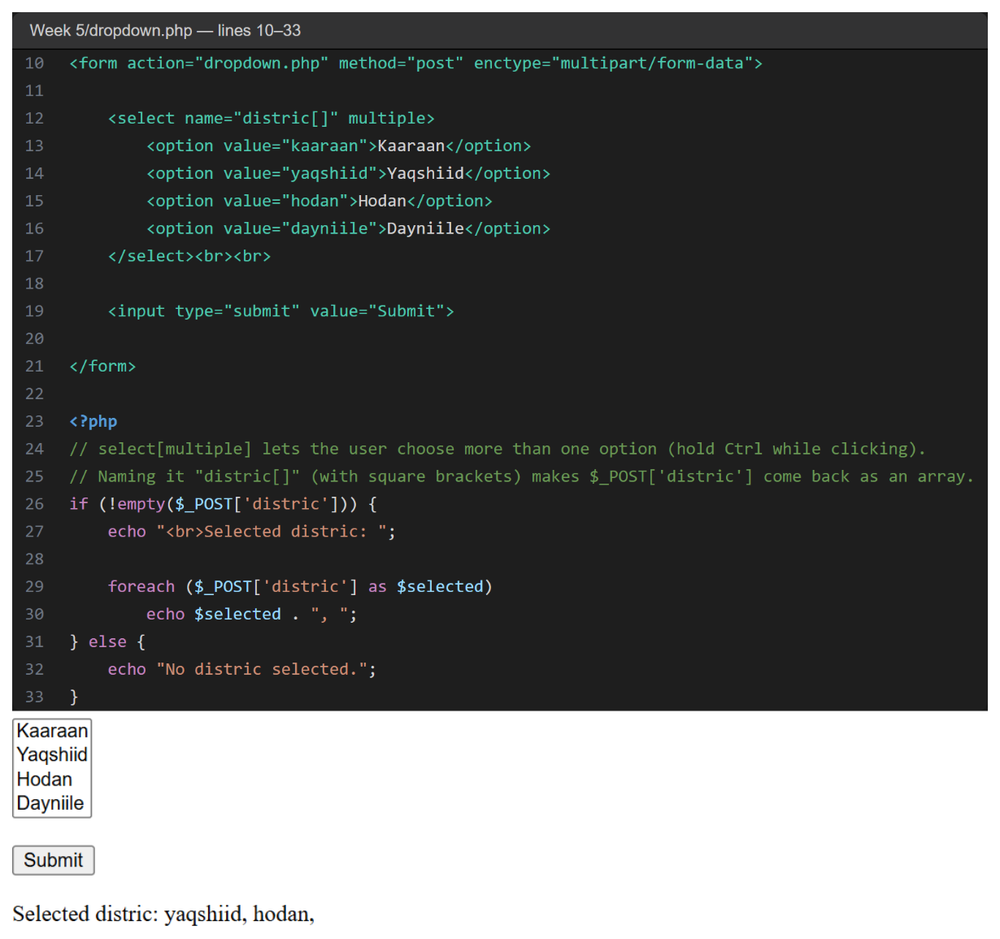
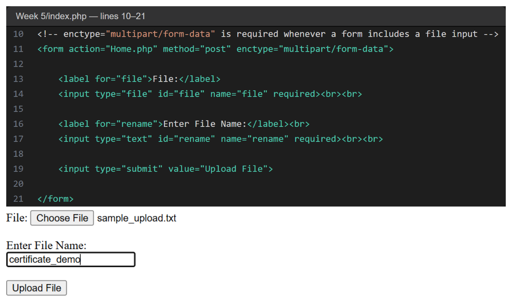
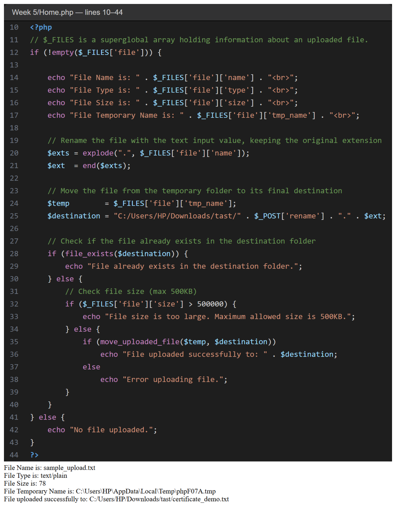

# Week 5 — Code Explanation

This week's code is split across three files: [`dropdown.php`](../dropdown.php), [`index.php`](../index.php) and [`Home.php`](../Home.php).
Each screenshot shows the **code** (top, with the real line numbers) and the **result in the browser** after actually submitting the form (bottom).

**To run it:** copy the `Week 5` folder into `C:\xampp\htdocs\` and rename it to `week5`. Start Apache, then open `http://localhost/week5/dropdown.php` or `http://localhost/week5/index.php`.

---

## 1. Listbox — Multiple Choice ([`dropdown.php`](../dropdown.php), lines 10–33)

- `<select name="distric[]" multiple>` lets the user pick more than one district at once (hold Ctrl/Cmd while clicking).
- The `[]` after the name makes `$_POST['distric']` come back as an **array**, one entry per selected `<option>`.
- `foreach ($_POST['distric'] as $selected)` prints every district the user chose, separated by commas.
- If nothing was selected, `$_POST['distric']` is empty, so the page prints "No distric selected." instead.
- The screenshot shows **Yaqshiid** and **Hodan** selected together, printing `Selected distric: yaqshiid, hodan,`.

---

## 2. The Upload Form ([`index.php`](../index.php), lines 10–21)

- The form has a `type="file"` input (`name="file"`) and a text input (`name="rename"`) for the new file name.
- Two attributes make the upload possible: `method="post"` and `enctype="multipart/form-data"` — without the second one, only the file's name would be sent, not its contents.
- `required` on both inputs stops the browser from submitting an empty form.
- The form's `action="Home.php"` sends the submitted data to `Home.php` for processing.
- The screenshot shows a file chosen (`sample_upload.txt`) and `certificate_demo` typed as the new name, right before clicking **Upload File**.

---

## 3. Receiving and Saving the File ([`Home.php`](../Home.php), lines 10–44)

- `!empty($_FILES['file'])` checks that a file actually arrived before doing anything with it.
- `$_FILES['file']['name']`, `['type']`, `['size']` and `['tmp_name']` are printed first, to show exactly what PHP received about the uploaded file.
- `explode(".", $_FILES['file']['name'])` splits the original file name at every dot; `end($exts)` then takes the **last piece**, which is the file's extension. This lets the new file keep the correct extension even after being renamed.
- `$destination` builds the final path: a fixed folder, plus the name the user typed in `rename`, plus the original extension.
- `file_exists($destination)` stops the script from silently overwriting a file that is already there.
- The size check (`$_FILES['file']['size'] > 500000`) rejects any file bigger than **500KB** before it is moved — the branch that used to run on a large file and skip on a small one was reversed; it now correctly blocks large files and allows small ones, matching the message it prints.
- `move_uploaded_file($temp, $destination)` moves the file out of PHP's temporary folder into its real destination, and returns `true`/`false` so the script can report success or failure.
- The screenshot continues the previous example: `sample_upload.txt` (78 bytes) is uploaded and saved as `certificate_demo.txt` in the destination folder.
